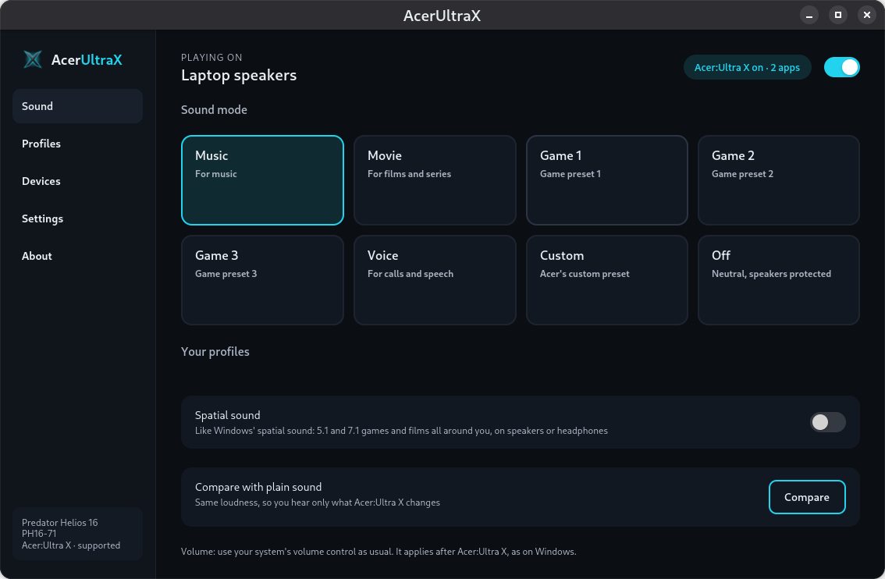
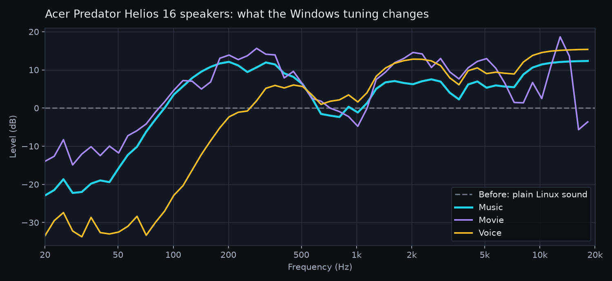
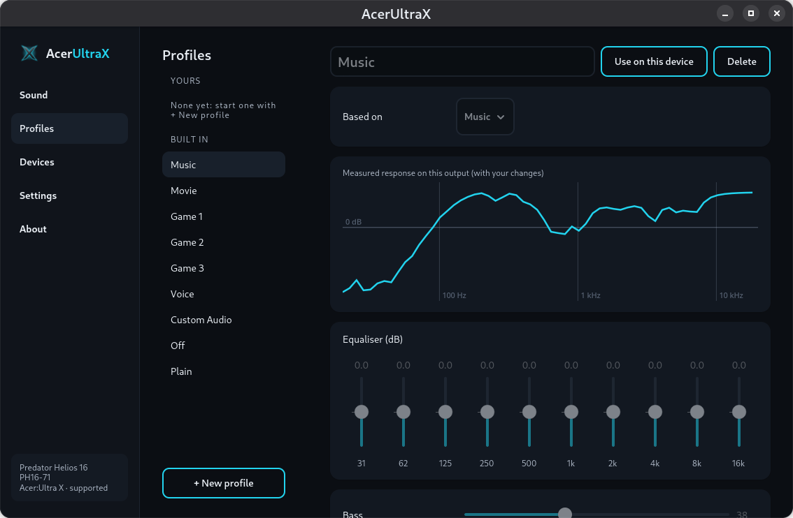
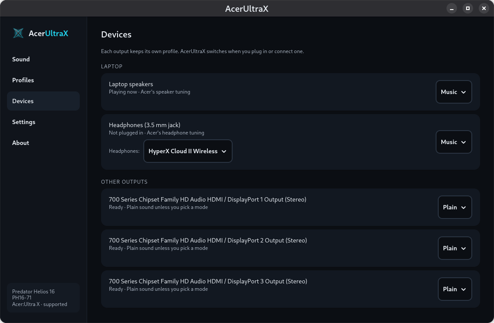
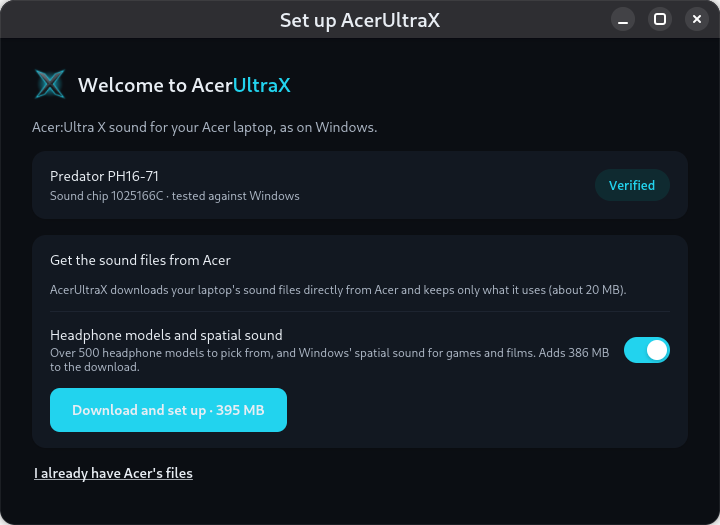
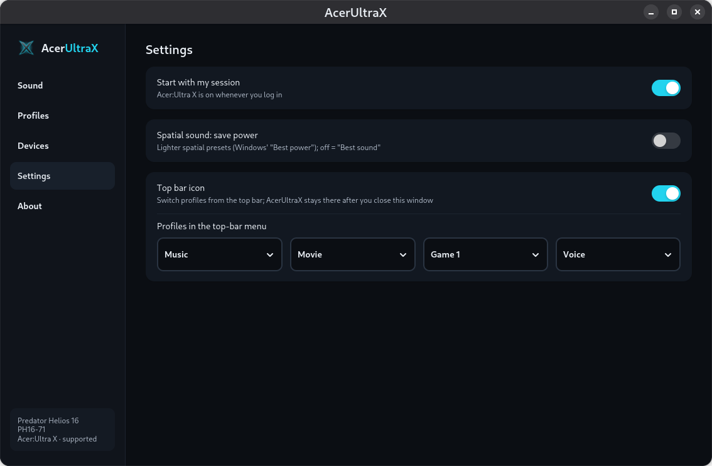

<p align="center"></p>

<h1 align="center">AcerUltraX</h1>

<p align="center"><b>Your Acer laptop's Windows sound, on Linux.</b><br>
DTS:X Ultra, natively, without Wine, on any distro.</p>

<p align="center"></p>

Acer gaming laptops sound great on Windows thanks to **DTS:X Ultra**: tunings Acer made for each laptop's own
speakers and for headphones. On Linux the same speakers sound flat and thin, because none of that runs.

AcerUltraX brings it back. It runs Acer's original DTS engine natively on Linux and processes your sound the way
Windows does, **sample for sample** (checked bit for bit against Windows).

## Before and after

What Acer's tuning does to the sound of the Predator Helios 16's speakers, measured by AcerUltraX itself. Plain
Linux sound is the flat dashed line:

<p align="center"></p>

- **Fuller sound:** the low mids (100–400 Hz), where small laptop speakers are weakest, come up by about 10 dB.
- **Clearer detail:** voices and instruments (1–5 kHz) and the air above 8 kHz come forward.
- **Protected speakers:** the deep bass the speakers cannot play is filtered out, as on Windows, so they don't
  rattle or distort at high volume.
- **Louder:** about 7–9 dB louder than plain sound at the same volume setting. Louder always *sounds* better,
  so the app has a loudness-matched **Compare** button to hear what really changes.

## Features

- **All of Acer's sound modes:** Music, Movie, Game 1–3, Voice, Custom, and Off (neutral, speakers protected).
- **Per device:** the laptop speakers, the 3.5 mm headphone jack and each Bluetooth device keep their own mode.
  Plug in headphones or connect Bluetooth and AcerUltraX switches by itself.
- **Headphone models:** like Windows' DTS app, pick your headphones from over 500 models (HyperX, Sony, Bose,
  Sennheiser, …); Bluetooth and USB headphones are recognised automatically.
- **Spatial sound:** Windows' spatial sound for 5.1 and 7.1 games and films, on speakers and headphones.
- **Your own profiles:** a 10-band equaliser plus bass, dialogue, surround and loudness controls, with the
  measured response curve updating as you change them.
- **Top-bar icon:** switch between four profiles of your choice from the top bar.
- **One-click setup:** AcerUltraX downloads your laptop's sound files straight from Acer and keeps only what it
  needs (about 20 MB).
- **Light:** about 20 MB of memory and well under 1% of one CPU core when idle; it rests when nothing plays.
- **Your volume keys as usual:** the system volume applies after the effects, with the same feel as on Windows.

<table>
<tr>
<td></td>
<td></td>
</tr>
<tr>
<td></td>
<td></td>
</tr>
</table>

## Supported laptops

> [!NOTE]
> I only have a **Predator Helios 16 (PH16-71)** to test on. Acer's DTS package has tunings for about 160 Acer
> laptops, and they should work the same way, but nobody has tried them yet. **If you have another Acer laptop,
> please try it and [tell us how it went](../../issues)**, with the output of `acerultrax-cli detect`. "It works"
> is just as useful as a bug report.

| Laptop | Status |
|---|---|
| Acer Predator Helios 16 (PH16-71) | ✅ **Verified** against Windows |
| Other Predator models with DTS:X Ultra (Helios, Helios Neo, Triton) | 🧪 Experimental: should work |
| Nitro, Swift and Aspire models with DTS:X Ultra | 🧪 Experimental: should work |
| Acer laptops whose tuning is not in Acer's package | 🛠️ Manual setup from Acer's support site |

The app tells you on first start which of these your laptop is. Requirements: a 64-bit Intel/AMD Acer laptop and
Linux with PipeWire and WirePlumber (the default on current Fedora, Ubuntu, Debian, openSUSE and Arch).

## Install

**Arch Linux, CachyOS, Manjaro, EndeavourOS:**

```sh
yay -S acerultrax-git
```

Then open **AcerUltraX** and click **Download and set up**. That's it: it is ready in about a minute and starts
with your session from then on. See the **[user guide](docs/USER_GUIDE.md)** for everything else.

**Other distributions:** build from source (below).

## Build from source

You need Rust, clang/lld/llvm (for the tests), and the PipeWire and GTK 4 development packages.

```sh
cargo build --release
./target/release/acerultrax-cli setup           # download Acer's files for this laptop and set them up
./target/release/acerultrax-cli autostart on    # start the background service, now and at every login
./target/release/acerultrax                     # the app
```

Everything works from the command line too:

```sh
acerultrax-cli status                           # what is playing where
acerultrax-cli mode movie                       # music, movie, voice, game1-3, "custom audio", off, plain
acerultrax-cli headphones hyperx                # search headphone models
acerultrax-cli headphone "hyperx cloud core" --device @headphones
acerultrax-cli compare on                       # loudness-matched comparison with plain sound
acerultrax-cli render song.wav out.wav --mode movie   # process a file offline
```

See [docs/TESTING.md](docs/TESTING.md) for the tests.

## How it works

- AcerUltraX contains **no DTS or Acer files**. On first start it downloads Acer's own driver package for your
  laptop from Acer's download server, checks it against known checksums, keeps the few files it uses and
  deletes the rest.
- A small built-in loader runs the DTS engine from those files natively on Linux: no Wine, no virtual machine.
- It runs the same signal chain as Windows: an engine per app, then the mix, with the factory settings from
  Acer's tuning files for your laptop.
- A background service routes your desktop's sound through it with PipeWire and follows the output you pick.
- There are no licence checks; the DTS engine has none on Linux either.

| Crate | What it does |
|---|---|
| `pe-loader` | Loads 64-bit Windows DLLs into a Linux process and provides the Windows functions they use |
| `dts-eagle` | Safe interface to the DTS engine; reads Acer's tuning configuration |
| `importer` | Detects the laptop, downloads and sets up Acer's files |
| `dts-spatial` | Windows' spatial sound encoder, loaded natively |
| `audio-graph` | The Windows signal chain: an engine per app, mix, mode engine, equaliser, loudness match |
| `daemon` | `acerultrax-daemon`: PipeWire routing, device following, profiles, control socket |
| `cli` | `acerultrax-cli` |
| `gui` | `acerultrax`: the app and its top-bar icon |

## Known issues

- **PH16-71: the headset microphone on the 3.5 mm jack does not work on Linux kernels from before August 2026.**
  This is a kernel issue, not AcerUltraX (which never touches microphones); the fix is in Linux (commit
  `04a8e286bb2e`). On an older kernel, add it as a driver option and reboot:

  ```sh
  echo 'options snd_sof_intel_hda_generic hda_model=alc2xx-fixup-headset-mic' | sudo tee /etc/modprobe.d/acerultrax-headset-mic.conf
  ```

## Support the project

If AcerUltraX made your laptop sound right, **[give it a ⭐](https://github.com/fawaz7/AcerUltraX)**: it helps
other Acer owners find it. Built by [Fawaz Al-Ghzawi](https://github.com/fawaz7).

## Legal

AcerUltraX is an independent project, not affiliated with or endorsed by Acer, DTS or Xperi. DTS and DTS:X are
trademarks of DTS, Inc.; Acer, Predator, Nitro, Swift and Aspire are trademarks of Acer Inc. AcerUltraX does not
include or redistribute their software: it downloads it from Acer, on your machine, for your own laptop.

## Licence

MIT, © 2026 Fawaz Al-Ghzawi. You may use, change and share AcerUltraX freely, including in your own projects;
keep the copyright notice in [LICENSE](LICENSE) so the original author is credited.
